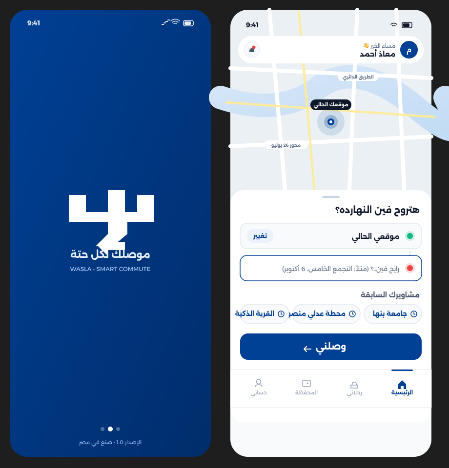

# وصلة (Wasla) — Frontend Implementation

Production-ready implementation of the **Wasla (وصلة)** Arabic ride-hailing app, matching the Figma design overhaul.



## ✨ Features
* **Dark Mode & Light Mode**: Built-in dynamic theme switcher button with customized night map, dark bottom sheet, and amber accents.
* **Full RTL Architecture**: Native `dir="rtl"` layout tailored for Arabic typography and reading ergonomics.
* **Alexandria Font**: Geometric Kufic Arabic typography loaded via Google Fonts.
* **Component Architecture**:
  * `SplashScreen.tsx`: Brand launch screen with custom vector logo and animated slogan.
  * `HomeScreen.tsx`: Interactive dashboard combining map, header, booking sheet, and navigation bar.
  * `MapBackground.tsx`: Stylized vector Cairo transit map with dynamic Day / Night modes, Ring Road (*الطريق الدائري*), 26th of July Corridor (*محور 26 يوليو*), the Nile river, and a pulsing live user pin (*موقعك الحالي*).
  * `HeaderBar.tsx`: Floating header with personalized user greeting (*مساء الخير 👋 معاذ أحمد*), notification badge, and the **Dark Mode Toggle Button**.
  * `BookingSheet.tsx`: Responsive bottom sheet with pickup/drop-off inputs, quick destination pills (*مشاويرك السابقة*), and full-width CTA button (*وصلني*).
  * `BottomNav.tsx`: 4-tab mobile navigation (*الرئيسية، رحلاتي، المحفظة، حسابي*) with active state indicators.
* **Design System Tokens**: Fully configured in `tailwind.config.js` with `darkMode: 'class'`.

## 🚀 How to Run

```bash
# Navigate to the project directory
cd wasla-frontend

# Install dependencies (already installed)
npm install

# Start local development server
npm run dev
```

Visit the displayed local URL (typically `http://localhost:5173`) in your browser to interact with the app.

## 📦 Build for Production

```bash
npm run build
```
Generates a static deployment package inside the `dist/` folder.
